# Commit's agentic model — Phase 6

Humans define authority. Deterministic server workflows act within that authority. Buyers explicitly approve their own exact PayPal order; the server then completes and verifies its authorization. The service worker and LLM have no commercial authority.

## Canonical authorization invariant — Phase 6.1A

> After explicit buyer approval, Commit may idempotently complete the exact pre-approved PayPal authorization and then verify provider state. Commit may not create buyer consent, alter the approved commercial terms, change the approved amount, substitute another proposal/envelope, or authorize an unapproved order.

Buyer consent is explicit in PayPal. Provider GET must confirm approval of the saved order before the deterministic server can complete its authorization. Current proposal/envelope, exact amount/currency/merchant and commitment bindings must pass before POST; currentness is checked again after the provider read. The authorization POST reuses the saved order and stable request key and sends no changed amount, payment source or PATCH of commercial terms. It grants no capture authority. An LLM, browser callback or service worker cannot create buyer consent or substitute financial terms.

After POST, Commit persists the authorization ID and independently GET-verifies order and authorization. Only a verified current active hold becomes locally `AUTHORIZED` and receives `PAYPAL_AUTHORIZED`. Uncertain outcomes remain uncommitted; stale/changed envelopes require fresh approval. Existing provider resources are read before retry, with durable leases, deduplicated events and the same operation key across restarts/duplicate returns. No normal-user provider-status action is needed. Capture retains its separate existing organizer grant and saga preflight.

The original Phase 6.1A GET-only requirement was a specification mismatch with PayPal AUTHORIZE completion. Both live provider flows passed; the historical FAIL and original receipts are preserved in [the revalidation report](phase-6-1a-payment-revalidation.md). This correction changes documentation and acceptance wording only.

## Three levels

| Level | Authority | What may happen |
| --- | --- | --- |
| Assist | Existing reviewed needs | Interpret, explain, compare, analyze, simulate and draft unpublished merchant offers. |
| Delegate | Explicit immutable human grant | Replan, apply qualifying offers, create Activity, or publish within a merchant standing policy. |
| Financial | Each buyer's actual PayPal approval | The deterministic server may idempotently complete and verify the exact pre-approved current authorization. Optional organizer delegation can trigger the existing capture saga only after every required approval and preflight. |

## Consumer authority

`consumer_mandates` records group/member, version, ACTIVE / PAUSED / REVOKED, replan and better-offer flags, approved hard-boundary fingerprint and timestamp. No grant exists by default. Saving requires the participant's session, membership, same-origin CSRF and explicit confirmation. Latest version wins; grants cannot be edited in place. A joined identity cannot select seeded personas.

The fingerprint references confirmed hard maximum, must-haves/quality/refund conditions and declared catalog stay dates; it does not duplicate private needs. Relevant changed boundaries produce a new PAUSED version and require confirmation. Unconfirmed needs, one missing grant, paused/revoked authority or changed fingerprint blocks group automation. All members must grant the applicable operation. Declared fresh-group dates are February 12–14, 2027; the create form explicitly discloses them. Declared catalogs cannot be changed in place.

Replanning uses the existing integer-cent best-value solver and deterministic `publicFacts()` explanation. Hard gates precede quality and ranking; an LLM cannot calculate or override them. A qualifying offer can rescue an infeasible price-blocked proposal, but cannot rescue a quality/configuration failure by lowering a floor. Internal variant IDs distinguish alternatives during ranking; the saved package ID and exact commercial terms stay intact.

Four participants are required by the current payment model. A smaller fresh group gets an invitation update rather than a malformed payment proposal. UI needs and Activity are scoped to the current participant and group.

## Merchant authority

`merchant_agent_policies` records immutable selected packages/dates, maximum discount, minimum margin, minimum size, minimum newly feasible groups, redemption cap, status and explicit auto-publication permission. Auto-publication is OFF initially. A merchant confirms the exact standing terms in Merchant Studio; updating or pausing creates another version. The AI tool allowlist cannot create/edit policies or call publication.

The server evaluates near-conversion demand in that envelope, requires the configured number of newly feasible groups in a deterministic simulation, and independently checks price, margin, maximum discount, dates and capacity. A policy may be stricter than the base merchant floors. A 9% or 25% request under an 8% policy fails; no silent clamp or authority expansion occurs. Manual offers retain the existing exact, expiring, single-use publication confirmation.

`publishWithinPolicy()` is server-only. Its receipt persists policy ID/version reference, anonymous demand snapshot and hash, exact immutable offer, simulation ID/result, trigger event, timestamp and audit actor. Draft → publication → receipt is one SQLite transaction using nested savepoints. Replayed events reuse a receipt; an active publication prevents repeated offers for the same policy. Exhaustion/revocation requires merchant review rather than unlimited new offers.

## Private needs → safe merchant signal

The consumer-side projector runs the solver using private confirmed needs. It stores an opaque random cohort ID, group size, public stay/package, aggregate GMV, coarse blocker/gap/quality band, commitment count and a 0–10% aggregate feasibility curve. It stores no name, user/group identifier, individual ceiling, private text, raw check or allocation. The consumer-only binding table maps a group to its opaque cohort. Merchant code reads only the projection and the independently declared 50 synthetic fixture cohorts.

The UI identifies fixture and projected cohort counts. AG queries and manual/AI simulations retain their current filtered scope, including projected cohorts. Merchant code never queries private constraint, mandate, session, commitment or consumer binding tables to simulate an offer. A projection reduces disclosure; it is not a formal differential-privacy guarantee, and the demo has no production tenant/authentication boundary.

## Durable event loop

```mermaid
flowchart LR
  N[Confirmed group needs] --> E[SQLite domain outbox]
  E --> W[Leased server worker]
  W --> P[Anonymous demand projection]
  P --> M[Merchant policy and deterministic simulation]
  M --> O[In-policy publication receipt]
  O --> C[All current consumer mandates]
  C --> S[Deterministic best-value solver]
  S --> V[New exact proposal version]
  V --> A[Durable recipient Activity]
  A --> U[Optional Web Push]
  V --> B[Explicit buyer PayPal approval]
  B --> H[Idempotent exact server authorization]
  H --> R[Provider-verified current authorization]
  R --> F[Optional organizer grant and existing saga preflight]
```

State transitions enqueue deduplicated events. `domain_events` persists PENDING / PROCESSING / PROCESSED / FAILED, attempts, retry time and lease. Claims use a SQLite transaction; expired leases are recovered after process restart. One consumer server runs the worker every second, observing persisted demand/catalog fingerprints and offer expiry independently of browser activity. The browser and service worker never run the solver, publish or initiate financial operations automatically.

Handlers recheck current grants and proposal revisions. Publication/application and exact versioned allocation writes are transactional. Duplicate deliveries cannot create a second policy receipt or saga. Failed handlers retry with bounded backoff, then retain FAILED and create review Activity; no hard boundary is weakened to clear a failed job. SQL persistence errors require operational repair. The current worker is a local single-instance design, not a hosted scheduler: the server must run, and process/service supervision is required for background availability.

## Activity and interruptions

Activity is persisted atomically with push delivery intents before network delivery. It is per recipient, survives failed push, keeps read/resolved timestamps and prioritizes unresolved actions. Superseded approval requests resolve when a new version arrives; a verified current approval resolves that participant's request. Critical approval/terms/payment/recovery/purchase updates always create Activity. Optional progress and recommendation push respect preferences. Lock-screen messages are generic; exact own shares stay in authenticated demo-session Activity.

Consumer Agent Activity explains solver actions and the participant's own mandate version. Merchant Agent Activity explains threshold, policy checks and publication authority. These are curated facts, not raw provider or outbox logs. Notification links include relevant group/proposal IDs. A different-group link stops rather than displaying a different purchase; an obsolete proposal link warns before showing the current exact terms.

Human action is required for missing/changed authority, no feasible option, explicit buyer approval, stale resource cleanup and financial recovery/manual review. Reranking and a qualifying lower price before buyer approval need no extra acceptance click when all applicable mandates permit them.

## Financial boundary

Automatic offer application creates a fresh proposal and NOT_STARTED commitments, never a PayPal order or buyer approval. Existing envelopes become STALE after material changes, including discounts. Existing orders require explicit cleanup before new approvals; the worker does not quietly void them. Old authorization IDs never satisfy new readiness.

The approval-completion handler operates only on an already-created order with explicit provider-confirmed buyer approval. It cannot create an order, buyer consent or a capture; its permitted authorization POST and subsequent verification follow the Phase 6.1A invariant above. This financial capability is server-only and is absent from AI tools and client/service workers.

Organizer auto-finalization is OFF by default and requires a separate explicit versioned grant. The saga persists an immutable organizer-grant reference for delegated invocations and rechecks the latest enabled grant after provider preflight, before freezing/capture. Revocation during verification blocks all captures. Manual finalization remains the existing explicit path. Only four current valid commitment envelopes can pass the existing Phase 3 local/provider preflight. It invokes `CaptureSagaService.finalize()`, retaining existing financial preflight checks, durable capture, reconciliation and compensation; the new authority guard adds a prerequisite, never removes an existing check. There is no new capture algorithm or LLM decision. The delegation attempt is audited before starting the saga; frozen transactions reject setting changes until recovery/terminal state, as with other frozen commercial terms. Failed preflight creates organizer review Activity; uncertain outcomes remain in the existing manual-review/recovery path. Accepted offer snapshots remain pinned according to Phase 5 semantics.

Phase 6 tests use a fake gateway for this trigger. No new real Sandbox capture, checkout or provider request was performed. Historical PayPal evidence remains separate and unchanged.

## Product and identity limits

Use Commit creates a fresh group; invites use a 256-bit capability, hashed at rest, seven-day expiry, maximum four members and separate session identities. Joining closes after any order begins. Invite links are sensitive: share deliberately and keep them out of public evidence. Demo sessions expire after 24 hours; there is no account-based identity recovery. This is demo identity, not production sign-in, merchant authentication or tenancy. Seeded exploration and the verified read-only February replay remain separate entry points.

Before real deployment: add authenticated buyer/merchant tenancy, invitation lifecycle/account recovery, supervised worker operations, metrics/alerts, queue delivery ownership for multiple workers and actual device push/install verification. Those limitations do not relax any current financial gate.
