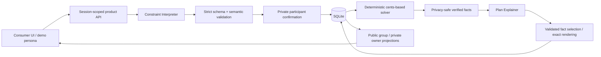
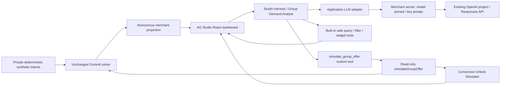

# Commit — canonical architecture

## Phase 6.1A — exact buyer-approved authorization completion

The canonical security/authority invariant is:

> After explicit buyer approval, Commit may idempotently complete the exact pre-approved PayPal authorization and then verify provider state. Commit may not create buyer consent, alter the approved commercial terms, change the approved amount, substitute another proposal/envelope, or authorize an unapproved order.

For PayPal AUTHORIZE checkout, buyer approval leaves an `APPROVED` order; Commit completes that exact order through `POST /v2/checkout/orders/{savedOrderId}/authorize`, then independently GET-verifies the resulting order and authorization. Automatic completion is a deterministic server operation within the buyer's existing exact approval. It is not restricted to GET-only polling. This corrects the original Phase 6.1A acceptance specification; the original FAIL reflected that specification mismatch, not a failed live provider flow. The implementation and historical receipts are unchanged. See [Phase 6.1A revalidation](phase-6-1a-payment-revalidation.md).

`AgentCoordinator` schedules only existing current checkouts through durable `APPROVAL_RECONCILE` events. `CommitmentService.reconcileApproval()` checks integrity, current proposal/envelope, approval deadline, cleanup, saga ownership and leases. `completeAuthorization()` first GET-verifies the saved order's AUTHORIZE intent, one purchase unit, exact amount/USD, commitment reference/custom ID and merchant. Without provider-confirmed buyer approval it sends no authorization POST. It rechecks currentness after that GET immediately before POST, reuses the persisted authorization request key within the retry window, and sends only the saved order ID and idempotency key through the adapter. It sends no changed amount, payment source or PATCH of order terms, and this completion handler does not capture funds.

The authorization ID is persisted before subsequent checks. Order and authorization GETs verify exact bindings, active `CREATED` authorization and valid times before the local `AUTHORIZED` transition and `PAYPAL_AUTHORIZED` audit. Unknown or failed verification remains uncommitted with automatic checking or attention. A stale/changed envelope cannot become current; fresh exact approval is required. Existing authorizations are read/adopted before any retry; stable request keys, leases and deduplicated events prevent repeated financial operations across returns/restarts. The normal consumer UI requires no manual provider-status action. LLMs and client/service workers cannot grant buyer consent or invoke this financial capability; capture still requires the existing separate organizer authority and saga preflight.

## Current architecture update — Phase 6

See [AGENTIC_MODEL.md](AGENTIC_MODEL.md) for current authority and [PWA.md](PWA.md) for delivery/deployment. This section updates earlier phase-scoped descriptions below without altering historical evidence.

Migration 6 adds immutable consumer mandates, merchant policies and group auto-finalize grants; leased/deduplicated domain events; aggregate merchant demand projections with consumer-only opaque bindings; recipient Activity; push subscriptions/preferences/delivery outbox; agent audit and immutable publication receipts; invitation tokens and independent demo identities. Node/SQLite remains the local runtime. Existing solver, provider adapter and capture/recovery saga remain the sources of commercial and financial truth.

The consumer server's worker runs independently of browser lifetime: event → private checked solver projection → merchant deterministic simulation and policy checks → atomic publication receipt → all current consumer mandates → best-value proposal version → durable Activity → optional encrypted VAPID push. No pair of LLM chatbots coordinates this loop. Browser and service-worker code have no automatic payment or offer-publication capability. The deterministic server worker may complete exact buyer-approved authorizations under the Phase 6.1A invariant above; separate merchant policies and organizer grants govern publication and capture.

The internal publication method revalidates latest explicit policy, exact simulation, price/margin floors, dates/packages and cap. It is absent from AG AI tools and public endpoints. Manual publication retains explicit reviewed confirmation. All buyer PayPal approval remains explicit. Optional organizer auto-finalization invokes the existing saga with unchanged financial protections, four current envelopes and independent provider preflight; uniqueness on proposal prevents repeat capture.

Projection storage contains random cohort keys, public package/dates and aggregate feasibility/discount curves. Merchant code cannot query private consumer bindings/constraints/mandates/sessions/payment records. Activity reads/writes and join identities enforce own session/group; stale notification links warn or stop. Invites are 256-bit hashed capabilities, seven-day expiry, four-person cap, closed after checkout begins. These controls are demo isolation, not production authentication/tenancy.

Static-only caching excludes APIs, dynamic financial pages and PayPal returns. Offline client mutations are disabled/blocked, never queued. Push lock-screen text is generic; durable recipient Activity contains the person's own share. Expired/invalid subscriptions are removed; retry failure preserves Activity. Critical facts never depend on delivery or badge.

Both current entry points default to the new isolated data/phase-6.sqlite and use Phase 6 cookie namespaces. Historical data/commit.sqlite and saved receipts are not used for Phase 6 verification. Exact configured HTTPS origins, Secure cookies and a protected proxy template support future staging; no staging host has been deployed. Worker leases/restart are verified locally, while multi-instance push ownership, service supervision, authenticated tenancy, metrics and real-device installation/delivery remain deployment work.

## Phase 5 offer loop — COMPLETE, PASS WITH LIMITATIONS

Migration 5 adds `merchant_offer_simulations`, `merchant_offer_versions`, `merchant_publish_confirmations`, `group_catalogs` and `offer_applications`. MerchantOfferService has cohort/catalog/offer capabilities only and never queries consumer-private tables. Simulations persist safe analytical receipts without commercial effects. Drafts inherit a valid same-session simulation; server validation independently enforces declared discount, price, margin, packages, dates and cap. Native Studio queries are bound to the exact filtered anonymous cohort scope, because native `execute_query` does not inherit dashboard filters itself.

The AG tool allowlist adds only `draft_group_offer`. No publish, consumer-proposal or financial capability is provided. Publication uses the separate human UI: reviewed draft → unchecked exact-terms checkbox → trusted click → session/draft/hash-bound five-minute single-use confirmation. CSRF, exact term digest, current boundaries and confirmation are checked transactionally. Published terms, simulation receipts and applied snapshots are immutable in SQL. This is a local demo capability boundary, not production merchant authentication.

ConsumerOfferService evaluates published eligibility with merchant/package/group-size/stay/booking-window/cap facts and then invokes the unchanged solver on legitimate discounted catalog input. The existing cent-ceiling price-component rule supplies new prices; score/allocation formulas stay unchanged. Organizer acceptance atomically reserves one redemption, preserves the previous proposal, increments the revision, marks old commitments stale and prepares fresh exact envelopes including offer identity/terms. The scoped effective catalog fingerprint applies only to scoped/offer groups; historical global-catalog fingerprint bytes remain unchanged. The February fixture declares separate 2027 merchant inventory and boundaries, preserving the original December catalog and verified transactions.

Superseded cleanup shares CommitmentService's existing verified void implementation, provider binding checks, leases and stable request IDs. Unknown/failed/unconfirmed cleanup blocks fresh payment creation/authorization; the organizer can retry. Unapproved old orders remain isolated and their obsolete proposal endpoint cannot authorize. Four fresh current approvals enter the existing CaptureSagaService without new capture logic. Verified success consumes the reservation; verified complete compensation releases it. Reservation reconciliation is transactional/idempotent and conservative after a crash. Abandoned reservations remain held pending a future explicit cancellation path.

V1 policy pins terms at explicit organizer offer acceptance. Expiry/revocation blocks new acceptances while preserving that exact accepted proposal through participant reapproval, with the existing payment deadline. No retroactive price change occurs; unavailable fulfillment requires explicit replanning. Merchant publication and consumer acceptance are separate human commercial actions. Audit contains entity/version/action, never private constraints or secrets. See [Phase 5 report](phase-5-report.md) for verification and limits.

Updated October 3, 2026 (local time). Original Phase 2 evidence predates Phase 1.1; Phase 2.1 revalidated the strengthened solver/envelopes and verified cleanup. **Phase 3 is COMPLETE — PASS WITH LIMITATIONS:** four exact Sandbox captures confirmed $1,515/$0 refunded, and a separate capture-3 rejection verified $785 in full refunds plus two voids. Durable terminal state survived actual restarts; mid-operation uncertainty/idempotency are covered by the 141-test suite. See [historical Phase 2](phase-2-report.md), [Phase 2.1](phase-2-1-report.md) and [Phase 3 evidence/report](phase-3-report.md). Payment feasibility and production limitations remain authoritative. Phase 4 is complete with an isolated read-only AG Studio origin; see its report.

## Application boundaries

One TypeScript Node.js product server on loopback port 3002, serving a responsive static consumer app and JSON API. Reuse the installed strict TypeScript/runtime/test tooling. SQLite via Node 24's built-in `node:sqlite` provides transactions, foreign keys, migrations, and durable local persistence in ignored `data/commit.sqlite`. No OR-Tools, framework migration, or payment-code rewrite is needed for the small catalog.

The existing PayPal harness on 3001 and its `src/payments.ts`, `src/store.ts`, `src/server.ts` behavior are preserved. `src/paypal.ts` now accepts an optional allocation-specific amount/checkout context; its original two-argument call still creates the spike's fixed $10 order. The Phase 2 product service reuses that transport through an authorization/verification/void-only boundary, with its own SQLite records and idempotency/reconciliation logic.

## Durable entities and relationships

| Entity | Phase 1 responsibility / later extension |
|---|---|
| User | Four synthetic people; stable ID and display name |
| Group / GroupMember | Session-isolated plan membership and organizer role |
| PurchaseGoal | Goal text, plan state, monotonically increasing revision |
| Constraint | Owner/group, validated private statement/structure, confirmation and revision |
| Merchant / MerchantPackage | Fictional catalog; integer prices, structured quality/dates/refund terms and private merchant boundaries |
| Proposal | Immutable revision and catalog snapshot, value-policy version, deterministic scores/ranks/comparison IDs and public explanation |
| ProposalAllocation | One per member; exact cents and private component breakdown |
| Commitment | Immutable allocation FK, exact commercial envelope/ceiling, revision/fingerprint, provider IDs/status/expiry, request keys and operation lease |
| PaymentEvent | Durable sanitized operation/status/request/debug evidence; existing spike evidence remains separate |
| MerchantOffer / OfferSimulation | Safe simulation receipts and immutable offer versions; AI drafts, separate human publication, deterministic eligibility and reserved/consumed redemptions |
| AuditEvent | Actor/action/entity/revision/time without private natural-language payload |
| DemoSession | Opaque HttpOnly cookie, active persona, isolated group; CSRF token and expiry |

Foreign keys enforce membership/allocation relationships. SQLite CHECK/UNIQUE constraints protect amount nonnegativity, state domains, group membership, one allocation per proposal/member, and provider identifiers/event idempotency. Migration versioning permits later tables/columns without destructive resets. Seed catalog idempotently; create demo groups transactionally per session.

## Server identity and privacy

An opaque demo session cookie holds no persona or budget. Server session row selects the seeded member persona; explicit `/api/persona` switches it. Group-scoped access and draft ownership are enforced on the server. Organizer status grants no extra access to constraints; any participant can request a solve. Merchant persona is denied private constraints and group/proposal endpoints. Mutation requests require matching Host/Origin and a session CSRF token; bounded JSON input, same-origin assets, safe error codes, no arbitrary filesystem serving, and no sensitive logs. Production sign-in, tenant isolation, encryption at rest, and deployment are future gates.

Group projection exposes names, confirmation status, assigned totals, actual commitment status, explicitly PUBLIC requirements/preferences, and observed authorized/captured totals. Private `/api/constraints/me` and `/api/commitments/me` include only the active owner's data. Public proposal projection hides other participants' private checks, solver scores derived from hidden preferences, ceilings, provider IDs, and other participants' components. The owner can see their own details. Infeasible alternatives use general unmet-needs messages rather than identifying a private blocker. Frontend clears the private view immediately during persona switching, discards drafts, aborts requests, and uses no private localStorage.

## AI interfaces

### Bounded Agency

AI may interpret, recommend, optimize, explain, and simulate. AI must not silently redefine commercial boundaries established by users or merchants. **Hard boundaries always override optimization; AI may never lower them merely to make a transaction possible.** Buyer boundaries include hard maximum spend, must-haves, quality floors, cancellation/refund properties and exact committed merchant/package terms. Merchant boundaries include minimum price/margin, maximum discount, eligible inventory/dates and redemption limits. Independent application gates enforce them before scoring; prompts alone are not the enforcement mechanism.

The interpreter has no database/catalog/scoring/financial tools. It can return only an allowlisted buyer draft, which cannot overwrite confirmed terms before explicit participant review. Unknown merchant-floor or scoring fields are rejected. The explainer can select supplied fact IDs only; it cannot introduce a score, relax a check or write new prose. Published weights/floors are frozen application constants. Merchant boundary data is read from the catalog and remains absent from buyer projections and AI explanation inputs.

`ConstraintInterpreter.interpret(statement): Promise<validated draft>` and `PlanExplainer.explain(publicFacts): Promise<fact selection>` are injectable interfaces. OpenAI Responses structured outputs use `strict: true`, `additionalProperties: false`, nullable explicit fields, no tools, `store: false`, server-only key, bounded timeout/output, and no automatic retry of paid requests. An independent runtime schema/semantic validator is mandatory. Statements are untrusted data; no prompt can change schema, publish visibility, calculate allocations, or invoke payments. Visibility from model output is forced private until participant confirmation.

Explainer chooses an ordered subset of supplied deterministic fact IDs. The server renders their exact sentences, including any amounts, preserving numbers and private boundaries. This deliberately constrains free-form prose to prevent hallucinated arithmetic or leakage. Live AI and offline demo adapters are labeled in every interpretation/explanation response; offline is explicit and limited, not an invisible error fallback.

Configured model is an environment setting, not a hard dependency on a newest model. Document live provider verification separately; tests use injected outputs and do not claim actual model execution. Current sources: [structured outputs](https://developers.openai.com/api/docs/guides/structured-outputs), [Node SQLite](https://nodejs.org/api/sqlite.html).

Live acceptance passed with `gpt-5.6-terra` on October 2, 2026; synthetic outputs and persisted proposal IDs are recorded in `live-ai-evidence.json` and `live-browser-evidence.json`. The explainer's provider schema enforces a nonempty selection with at most four IDs (or the available fact count if smaller); the renderer independently validates uniqueness and membership before producing exact sentences.

## Deterministic solver and consistency

All money is safe integer cents. Shared costs split with stable remainder allocation; participant-specific tickets/rentals/bed supplements are additive. Price conservation is verified independently. Constraint keys/types are allowlisted; unsupported hard keys fail closed. Every hard participant check must pass, then quality floors must pass, before an option can receive optimization scores. Merchant gates also must pass: total >= minimum price; `(total - cost) * 10000 >= total * minimumMarginBps`; discount <= maximumDiscountBps of the configured list total; stay dates inside eligible dates; available inventory >= 1; redeemed count below redemption limit. List total is quoted total minus shared lodging quote plus configured list shared lodging price. All prices, basis points, stock counts, quality values and real ISO dates are validated; absent/malformed terms fail closed.

`bounded-value-v1` freezes product quality floors at rating >= 4/5, review count >= 25 and accommodation quality >= 3/5. Confirmed buyer floors may be stronger. All catalog entries supply rating, review count, accommodation level (1–5), NONE/PARTIAL/FLEXIBLE cancellation, distance in minutes, allowlisted amenities, dates, cancellation deadline and refund percentage. FLEXIBLE requires 100% before the displayed deadline; NONE requires 0%; PARTIAL requires 1–99%. These are fictional merchant declarations and explicit demo policy, not verified external quality evidence.

Normalize and round each score to 0–1000 with `clamp(round(x), 0, 1000)`:

| Dimension | Deterministic rule |
|---|---|
| Price efficiency | `1000 * lowestFeasibleTotal / optionTotal`; a zero-price option scores 1000 |
| Quality | Weighted normalized rating 30%, review evidence 10%, cancellation 20%, accommodation 25%, distance 10%, amenities 5% |
| Preference fit | `1000 - softPenalty / 20`; preferred-ceiling overage adds cents; excess distance adds 100 × minutes × weight; requested parking absent adds 2500 × weight; canDrive gives no invented credit |
| Fairness | `1000 - 1000 * (largestShare - smallestShare) / meanShare`; zero total scores 1000; share spread includes explicit individual add-ons |
| Value | Price efficiency 25% + quality 35% + preference fit 25% + fairness 15% |

Quality components: rating × 200; min(review count, 200) × 5; cancellation NONE=0/PARTIAL=500/FLEXIBLE=1000; accommodation × 200; `(30 - min(distanceMinutes, 30)) * 1000 / 30`; amenities count × 250 for wifi, breakfast, shuttle and hotTub. Rating, reviews and distance are normalized/rounded before the quality weighted sum. Fairness compares actual shares and never reallocates costs according to private budgets. The simple fairness and preference normalizations are demo policy requiring later user research.

Rank feasible options by value descending, quality descending, total ascending, then stable package ID. Persist ranks and comparison IDs: Recommended uses rank 1; Lowest Cost uses feasible total/ID; Best Experience uses feasible quality descending, total/ID. Infeasible entries have null scores/rank and no comparison badges. Public cards expose prices, declared quality, price-efficiency/quality scores and ranks; hidden preference/fairness/value scores remain internal. Human-readable explanations contain exact deterministic facts only, without private ceilings/preferences or merchant costs.

AI work occurs outside DB transactions. A solve snapshots group revision, confirmed constraint versions, merchant identity and full catalog. On completion, a short transaction compares the revision, merchant and exact catalog again before persisting proposal/allocations; catalog changes yield CATALOG_CHANGED_TRY_AGAIN. Persist the catalog snapshot and value-policy version in the immutable result. Render proposal/envelope terms from this approved snapshot rather than mutable live catalog. Constraint confirmation increments revision and marks earlier proposals stale transactionally. Failed interpretation leaves confirmed constraints intact; explanation error creates no misleading proposal. Concurrent solves reuse the same persisted revision or reject conflict. Restart preserves confirmed constraints and immutable proposal IDs.

## Commitment envelope and migration

Persist `approved_envelope_json` per allocation-linked commitment: proposal ID/version, merchant/package IDs, participant ID, exact amount ceiling/USD, buyer hard spend ceiling/conditions, material package fields (including price components, quality, amenities, distance, availability/capacity/beds, dates and cancellation/refund terms), private merchant-boundary fingerprint and value-policy version. The owner can inspect commercial terms without merchant internal costs/margins. A NOT_STARTED envelope is preparation only; actual buyer approval occurs through the separate checkout lifecycle.

Currentness requires exact envelope equality plus the proposal fingerprint. Fingerprints cover goal, membership/roles, confirmed constraints, allocations/components, merchant identity, live package data/boundaries, approved catalog snapshot and policy version. Any material mismatch makes an active commitment STALE, blocks readiness/reuse, retains known resource IDs, and requires a new version/envelope/approval. Conservatively, any selected package-field change is material; the AI cannot decide that changed terms are compatible.

Migration 3 adds the nullable envelope column transactionally. It enriches only known fictional seed packages missing structured attributes, retaining existing prices/terms. Legacy PROPOSED records are invalidated for the new policy, current goal revisions advance, and nonterminal commitments become STALE without backfilling approval to invented terms. VOIDED/CAPTURED/REFUNDED history, IDs, immutable allocations and confirmed buyer constraints are preserved. No migration calls the payment gateway. New proposals obtain complete envelopes from their own persisted snapshots.

## Later merchant agent safety

AG Studio must preserve three distinct capability boundaries. `simulateGroupOffer()` is AI-callable and read-only: calculate a hypothetical bounded outcome without changing offers, prices, inventory, proposals, commitments or payment state. `draftGroupOffer()` may persist an unpublished versioned draft only after deterministic merchant-boundary validation; it cannot accept a buyer offer or make terms redeemable. Neither path may lower merchant price/margin floors, exceed discount/redemption limits or change eligible inventory/dates to force feasibility.

Publishing has no AI-callable tool. The merchant must explicitly confirm the exact draft/version and displayed commercial terms in the UI. The server authenticates merchant ownership, validates the confirmation against that version, rechecks current merchant floors/inventory/dates/redemptions, publishes and audits transactionally. A changed draft or boundary invalidates confirmation. Buyer acceptance and commitment approval remain human decisions. Phase 4 implements only the read-only AG Studio simulation/query/dashboard tools. Draft, publication and acceptance routes remain future contracts.

## Payment integration

Group → Proposal → Allocation → Commitment → separate PayPal order/authorization. Organizer never owns the funds. READY_TO_CAPTURE is a validated application predicate, not a PayPal group operation. Phase 2 implements authorization and verified void; Phase 3 adds individual full captures, durable idempotency, uncertain-outcome reconciliation, compensating full refunds and voids for uncaptured holds. Pending capture/refund never counts as completed. No approved-share increase, partial capture or Venmo assumption is permitted.

APIMatic remains honestly documented in [apimatic-verification.md](apimatic-verification.md). Its tools are not consumed unless actually callable and used. The PayPal report is preserved unchanged during Phase 1.

## Phase 2 implementation contract

The product reuses `PayPalAdapter` with a backward-compatible allocation amount and checkout return URL. The spike retains its $10 default and separate capture controller. The product payment service receives an authorization/verification/void-only interface; it has no capture method or route. Standard PayPal-hosted approval links open from the participant's Commit page, followed by a server verification action. Return query parameters never establish approval or identify a financial resource.

Migration 2 introduced durable per-allocation commitments; migration 3 adds the commercial envelope and invalidates legacy approvals for the updated policy as described above. Each new feasible immutable allocation gets one durable Commitment, with integer cents, USD, exact envelope, proposal revision/fingerprint, timestamps, observed provider statuses, order/authorization IDs, and stable operation request keys. A separate proposal financial state preserves the planning-state domain. One commitment per allocation prevents duplicate active records. Retrying an uncertain operation reuses its persisted request key; a voided commitment needs an explicitly confirmed fresh proposal revision before another approval.

Short SQLite transactions persist keys and operation leases before network calls. No network request runs inside a SQL transaction. Durable leases serialize double submissions across service instances; process failure permits recovery after lease expiry. Creation/authorization retries stop after the verified six-hour Orders idempotency window. A known order is read before any authorization retry. An authorization ID is persisted before amount/status verification, including mismatch and stale-result cases. Sanitized payment events and the required audit actions record every consequential transition.

The server verifies AUTHORIZE intent, one purchase unit, exact USD allocation, commitment reference/custom ID, order/authorization correspondence, no captures, CREATED authorization status, creation/expiry times and merchant consistency. Readiness requires all required current-version commitments, exact amounts, no pending operations, verification within five minutes, unexpired authorizations and a conservative application deadline of 24 hours from the earliest authorization. Its financial/goal state and audit transition update in one SQL transaction. This deadline is an application policy, not a PayPal guarantee. Group refresh reads actual provider resources without approving or capturing anything and runs after each successful authorization. Stale checks are labeled for refresh; they may still correspond to a hold, which remains visible in the owner's ledger.

Every confirmed needs change makes older active commitments STALE atomically. Package, membership or allocation fingerprint changes also block readiness and approval reuse. Increased and decreased shares both require a new version and approval; Phase 3 captures only the exact approved share and introduces no partial-capture compatibility. Completed/refunded/voided transaction history remains intact. Stale authorization IDs remain available privately for reconciliation and manual void. Automatic void on replanning is deferred; explicit participant void, saga compensation and Sandbox cleanup are supported and verified through the API.

## Phase 2.1 revalidation contract

Recompute the current seeded solution rather than relying on the earlier $1,455 fixture. Before any new order, compare each persisted envelope against the current immutable proposal/catalog snapshot and confirmed owner conditions; save sanitized SHA-256 evidence, material public terms, and merchant-boundary checks. Keep private buyer conditions out of PayPal metadata. Independent Sandbox order/authorization GETs must prove exact USD amounts, opaque commitment bindings, current versions, distinct resources, no captures and all-current readiness.

Use a realistic group-scoped needs change to prove live AUTHORIZED → STALE, zero stale contribution, rejected old-proposal reuse and explicit fresh approval. Current policy invalidates the entire immutable group proposal, so all four participants require fresh approval even when only one person's amount changes. A separately tested price-only reduction must identify unchanged non-price terms; the exact-price/version envelope still stales and does not permit partial capture or authorization reuse. Distinguish live observations from fake-gateway regression evidence in the report. Save ready snapshots before verified owner void cleanup; do not leave a cleaned fixture falsely READY_TO_CAPTURE. No capture method/route or Phase 3 implementation is introduced.

Shared projections contain participant names, shares, commitment status, authorized total, captured total and readiness. Only the current participant sees their commitment's provider IDs/checkout URL and their own private constraints/components. Synthetic persona switching remains deliberate demo behavior; production authentication, merchant onboarding, webhooks and deployment are deferred. Polling/reconciliation is sufficient for local Sandbox verification and is not presented as a production webhook solution.

## Phase 3 — durable capture saga (complete)

The organizer explicitly confirms the exact frozen proposal. A separate CaptureSagaService receives financial capabilities; AI and participant approval services do not. Each proposal has one SQLite saga and three journal steps per member (capture/refund/void), with stable 35-character SHA-256-derived request IDs committed before POST. Execution is Kelly, Lawrence, Sarah, Alex; exact full shares only, final_capture=true. No atomic multi-order guarantee exists.

Local envelope, revision, boundary and expiry checks run first. If a delayed organizer click finds verification older than five minutes, it refreshes the unchanged order/authorization facts through GETs, then reruns every strict local check, including freshness. Any refresh failure, void, capture, amount mismatch or changed envelope blocks all financial POSTs. The saga then independently reads all four resources again before freezing. SQL freeze triggers protect proposal/allocation/envelope terms and active buyer/catalog/member changes; a durable lease excludes concurrent runners. No SQL transaction spans network I/O. Completed or compensated proposal history remains intact when a new revision requires fresh commitments.

```mermaid
stateDiagram-v2
 [*] --> PREFLIGHT
 PREFLIGHT --> READY: all local and provider checks pass
 PREFLIGHT --> REQUIRES_MANUAL_REVIEW: blocked, zero captures
 READY --> CAPTURING: freeze exact terms
 CAPTURING --> RECONCILING: unknown or pending capture
 RECONCILING --> CAPTURING: GETs resolve outcome; same key if safe
 CAPTURING --> CONFIRMED: four independent COMPLETED capture GETs
 CAPTURING --> CAPTURE_FAILED: definite rejection
 CAPTURE_FAILED --> COMPENSATING
 COMPENSATING --> COMPENSATED: all captured shares refunded; other holds voided
 COMPENSATING --> COMPENSATION_FAILED
 COMPENSATION_FAILED --> COMPENSATING: explicit reconciliation/resume
 RECONCILING --> REQUIRES_MANUAL_REVIEW: conflicting resources or retry limit
```

CONFIRMED is impossible without four journal captures marked SUCCEEDED by actual GET verification. A browser return or capture POST response does not confirm the group. Failed groups never show booking success. COMPENSATED means verified COMPLETED full refunds and VOIDED uncaptured authorizations, including the rejected participant's hold; it leads to REPLAN_REQUIRED. Refunds are distinct operations and may be pending or fail.

REQUESTING survives process loss and is treated as uncertain. Known IDs are adopted before subsequent verification. Unknown capture reconciliation reads order/auth/capture before retrying the identical request key, with at most three POST attempts and a 45-day financial retry window. Unknown refund reconciliation uses order refunds, capture state and refund GETs; conflicting or undiscoverable settled resources require review. Public progress exposes assigned shares and operation states; financial IDs remain owner-only, with sanitized acceptance reports.

Production requires an authenticated, verified, deduplicated PayPal webhook inbox that wakes this same reconciliation runner, plus a scheduled durable worker/recovery process. This localhost phase uses explicit API reconciliation and resume. It never fabricates webhook delivery. Inventory reservation, real identity, production merchant routing, partial capture and external booking fulfillment remain deferred.

## Phase 4 — isolated AG Studio merchant console

`src/merchant/server.ts` runs independently on loopback port 3005. It imports the solver/seed/domain for analytical reuse, but no consumer database, service, commitment, saga or PayPal transport. It exposes merchant session, demand, simulation and model-turn routes only. Its separate `commit_merchant` HttpOnly/SameSite=Strict cookie never replaces the consumer cookie. POSTs require matching Origin and CSRF token; sessions expire, model turns are bounded and serialized, and errors are sanitized. This is a fictional local identity, not production merchant authentication. No database migration or catalog write is introduced.

The private fixture uses 50 fixed cohort IDs and confirmed typed synthetic needs. Three independently cloned packages declare 2027 inventory and capacities for the merchant demo. Consumer package definitions and solver semantics remain unchanged. Merchant projection has only anonymous group size/date/package/quote/stage/blocker, coarse gap/quality and derived feasibility/progress flags. Studio fields are explicitly declared rather than inferred from private objects. A linked cohort-to-funnel table supports cumulative milestones and cross-filter propagation; fanout aggregation is prevented. No raw participant record is serialized. Production ingestion and stronger aggregation/disclosure controls are deferred.

`AgStudioProvider` registers `AgStudioAiModule`; `AgStudio` owns the dashboard, filters, layout, native widgets and chat. A custom React widget is registered with `createWidgets`; its mapped cohort field is queried through `widgetApi.getData`, so simulation receives exactly the filtered cohort IDs. An empty scope stays empty. Requests are generation/abort guarded, and results from a different cohort scope are cleared.

`createAiHarness` runs the custom Group Demand Analyst through `directLlmRunner` and an application `AgLlmAdapter`. Built-in query/filter/add/configure/position tools work against only the safe browser data engine. The backend permits these tool names plus the custom simulator and pins the existing server model. It converts framework history/tool definitions to OpenAI Responses with `store:false`, no provider-state replay IDs, no client model override and no credentials in the bundle. Completed text/function-call responses are mapped back to framework events; transport is buffered per model turn rather than token-streamed. The Studio harness owns tool execution and the agent loop.

`api.defineAiTool` defines `simulate_group_offer` with integer discount 0–100, optional minimum group size 2–6, ISO dates and eligible package IDs. The tool adds the current filtered cohort scope and calls the deterministic server. Inputs reject unknown fields; discount above 10% or dates outside January–March 2027 reject the request without silently changing it. Each applicable private fixture is evaluated before/after using the unchanged solver, including buyer, quality and merchant hard gates. Shared and per-person price components round upward to integer cents. Incremental GMV/revenue sum discounted quotes only for newly feasible groups; cost sums their original-minus-discounted quotes. No taxes/fees, predicted conversions or campaign-wide discounts on already feasible groups are included. Inventory is checked per cohort; no reservation or aggregate campaign stock allocation is promised.

No draft/publish/price/payment tool or route exists. Dashboard document edits are ephemeral analytics only. AG licensing is supplied to the browser provider at runtime from ignored local configuration; the trial key is not embedded in source or generated bundles. `OPENAI_API_KEY` remains server-only. The merchant-only CSP permits AG inline styles while restricting scripts/connections to self; the consumer CSP remains unchanged. Build metadata rejects private server modules in the browser import graph.

The current local trial is evaluation-only and expires November 17, 2026. Persisted dashboards/chat, authenticated merchant tenancy, audited durable operations, production deployment and offer publication remain deferred. See [Phase 4 report](phase-4-ag-studio-report.md) for exact versions, evidence, tests and the Phase 5 gate.
